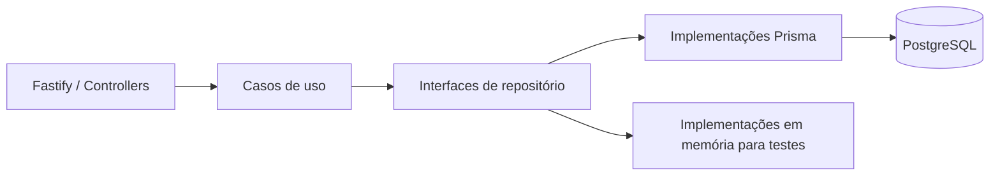

# GymPass API

**API de check-ins em academias com regras de distância, frequência e tempo.**

Projeto backend em TypeScript que permite cadastrar usuários, autenticar sessões, buscar academias e registrar check-ins. As regras de negócio ficam em casos de uso com repositórios substituíveis, permitindo testá-las em memória e exercitar a camada HTTP com PostgreSQL.

[Executar localmente](#executar-localmente) · [Regras de negócio](#regras-de-negócio) · [API](#endpoints) · [Testes](#testes)

## Funcionalidades

- Cadastro com senha armazenada como hash e autenticação JWT.
- Token de acesso e renovação de sessão por cookie.
- Consulta de perfil, histórico e quantidade de check-ins.
- Busca de academias por nome e por proximidade.
- Cadastro de academias restrito ao perfil `ADMIN`.
- Criação e validação de check-ins.

## Regras de negócio

| Regra | Implementação |
|---|---|
| O usuário deve estar a até 100 metros da academia | Cálculo de distância entre coordenadas no [caso de uso de check-in](src/use-cases/check-in.ts) |
| Apenas um check-in por usuário por dia | Consulta de check-in na mesma data antes de persistir outro |
| Validação até 20 minutos após a criação | Regra temporal no [caso de uso de validação](src/use-cases/validate-check-in.ts) |
| E-mail único no cadastro | Validação no caso de uso e restrição no schema Prisma |

Essas regras possuem testes junto dos casos de uso, incluindo cenários inválidos de distância, data e horário.

## Arquitetura e decisões técnicas



- **Injeção de repositórios nos casos de uso:** permite substituir a persistência sem mudar a regra de negócio. Veja [contratos](src/repositories) e [implementações em memória](src/repositories/in%20memory).
- **Factories para compor dependências:** conectam casos de uso aos repositórios Prisma na camada HTTP. Veja [factories](src/use-cases/factories).
- **Validação na entrada com Zod:** mantém os contratos de requisição próximos dos controllers.
- **Testes HTTP com Supertest:** exercitam autenticação, academias e check-ins. O ambiente de testes cria schemas PostgreSQL separados: [ambiente Prisma](prisma/vitest-environment-prisma/prisma-test-environment.ts).

Stack: **Node.js, TypeScript, Fastify 5, Prisma 6, PostgreSQL, Zod, bcryptjs, Vitest e Supertest**.

## Executar localmente

Requisitos: Node.js 20.17+, npm, Docker e Docker Compose.

```bash
git clone https://github.com/danielharrisonlf/GymPass.git
cd GymPass
npm ci
cp .env.example .env
docker compose up -d api-solid-pg
npx prisma generate
npx prisma migrate deploy
npm run start:dev
```

O exemplo configura a API em `http://localhost:3000` e o PostgreSQL em `localhost:5434`. Aguarde o banco aceitar conexões antes das migrations. Configure `JWT_SECRET` no `.env`; o valor do exemplo é apenas para desenvolvimento.

O Compose referencia a imagem `bitnami/postgresql` sem uma versão fixa. Se ela não estiver disponível no seu ambiente, use um PostgreSQL compatível e ajuste `DATABASE_URL`.

## Endpoints

| Método | Rota | Acesso / finalidade |
|---|---|---|
| POST | `/users` | Público: cadastrar usuário |
| POST | `/sessions` | Público: autenticar e obter token |
| PATCH | `/token/refresh` | Cookie de refresh: renovar sessão |
| GET | `/me` | JWT: consultar perfil |
| GET | `/gyms/search` | JWT: buscar academias |
| GET | `/gyms/nearby` | JWT: buscar academias próximas |
| POST | `/gyms` | JWT + `ADMIN`: cadastrar academia |
| POST | `/gyms/:gymId/check-ins` | JWT: registrar check-in |
| PATCH | `/check-ins/:checkInId/validate` | JWT: validar check-in |
| GET | `/check-ins/history` | JWT: histórico do usuário |
| GET | `/check-ins/metrics` | JWT: quantidade de check-ins |

Exemplo de cadastro:

```bash
curl -X POST http://localhost:3000/users \
  -H 'Content-Type: application/json' \
  -d '{"name":"Demo","email":"demo@example.com","password":"demo123456"}'
```

Autentique com `POST /sessions`, enviando `email` e `password`, e use o campo `token` retornado em `Authorization: Bearer <token>` nas rotas privadas.

O cadastro cria usuários `MEMBER`. Para explorar a criação de academias no ambiente local, configure um usuário `ADMIN` pelo banco, por exemplo com `npx prisma studio`.

## Testes

```bash
# Casos de uso: repositórios em memória
npm test

# Casos de uso em modo watch
npm run test:watch

# HTTP/E2E: exige PostgreSQL e DATABASE_URL configurados
cp .env .env.test
npm run test:e2e

# Build
npm run build
npm start
```

O script `test:e2e` prepara o pacote local do ambiente Prisma por meio de `npm link`. A conta do banco usada nos testes precisa poder criar e remover schemas. Os testes são separados dos casos de uso por diretório e configuração no [vite.config.mts](vite.config.mts).

## Estrutura

```text
src/http/          Controllers, rotas e middlewares
src/use-cases/     Regras de negócio, factories e testes unitários
src/repositories/  Contratos, Prisma e implementações em memória
src/utils/         Cálculos e funções auxiliares
prisma/            Schema, migrations e ambiente de testes
```

## Escopo e próximas evoluções

O foco é uma API de estudo com regras de negócio testáveis. O cookie de refresh está configurado com `secure: true`, exigindo HTTPS para o fluxo de renovação no navegador. A rota de validação de check-in atualmente exige JWT; ampliar a autorização por perfil nessa operação e adicionar observabilidade são caminhos de evolução.
